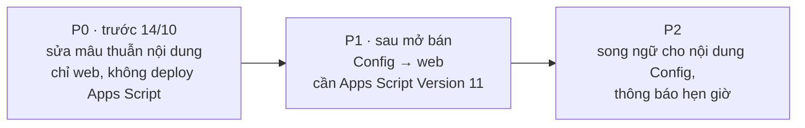

# Đồng bộ nội dung web với tab `Config` của Google Sheet — khảo sát & đề xuất

> **Trạng thái (11/10/2026):** chủ dự án duyệt P0 + P1 → **đã làm ở web v2.9.0 + Apps Script Version 11** (chờ chủ dự án deploy, Runbook §3c). Địa chỉ nhận hàng: thêm ô nhập khi giữ chỗ (P0-5 phương án b). Email hỗ trợ, giao hàng, đổi trả: đưa vào Config. `PAYMENT_DEADLINE_HOURS`: **đã làm ở v2.10.0** (chủ dự án duyệt 11/10; cùng Version 11) — xem §6. Phần dưới giữ nguyên làm hồ sơ khảo sát.
> **Khảo sát trên:** web v2.7.0 (`Mau_Dang_Ky_Internal_Sales_3009.html`), `apps-script/Code.gs` (Version 10 đang chạy), Sheet chính thức đọc ngày 11/10/2026.
> Số dòng `file:line` là của nhánh `v2.8-wave3-docs` lúc khảo sát; có thể lệch vài dòng sau khi sửa.

---

## 0. Kết luận

1. **Hiện tại sửa tab `Config` gần như không làm web đổi gì.** Trong 7 dòng Config, chỉ `ENABLE_AUTO_EMAIL` thực sự được dùng [VERIFIED code]:
   | Key | Ai đọc | Bằng chứng |
   |---|---|---|
   | `ENABLE_AUTO_EMAIL` | Máy chủ + công tắc ADMIN trên web | `Code.gs:294`, `Code.gs:1966` |
   | `MAX_PER_EMPLOYEE` | Chỉ form đăng ký **cũ** `register_` (không còn dùng) | `Code.gs:1659` |
   | `PAYMENT_DEADLINE_HOURS`, `BANK_NAME`, `BANK_ACC`, `BANK_HOLDER`, `SYS_STATUS` | **Không ai đọc** (chỉ được tạo lúc cài đặt) | `Code.gs:2310–2316` |
   Web **không có lệnh nào** lấy Config từ máy chủ.
2. **Hạn mức 2 sản phẩm:** máy chủ đã chặn đúng theo **từng chương trình** — cột I `MaxPerEmployee` tab `Programs`, PM đặt ở ô "Hạn mức" khi tạo chương trình (`#prog-max`, 1–10). **Không phải** `Config!MAX_PER_EMPLOYEE`. Đầu trang và banner PM đã hiện đúng số này, nhưng **6 chỗ khác ghi cứng "1 SP / NV"** → đặt 2 thì web tự mâu thuẫn (mục 2, dòng P0-3).
3. **Có 4 mâu thuẫn nội dung cần sửa trước 14/10** dù có làm đồng bộ Config hay không (P0-1 → P0-4): cú pháp chuyển khoản 4 kiểu, 2 email hỗ trợ khác nhau, thể lệ ghi sai mốc 24 giờ và hứa giao "đến địa chỉ đã đăng ký" trong khi web không hỏi địa chỉ.
4. **Rủi ro bảo mật nếu đồng bộ số tài khoản ngân hàng từ Sheet:** Sheet đang để "Anyone with the link — Editor". Ai có link đổi được số tài khoản nhân viên chuyển tiền vào → **rủi ro lừa đảo**. Điều kiện bắt buộc trước khi đồng bộ thông tin ngân hàng: Sheet **Restricted** + nhật ký thay đổi (mục 4).

---

## 1. Ưu tiên đề xuất



| Mức | Nội dung | Cần deploy Apps Script? | Công sức (ước) |
|---|---|---|---|
| **P0** | 7 mục ở §2: sửa chữ mâu thuẫn, hạn mức theo chương trình | Không | ~½ ngày + test |
| **P1** | Lệnh mới `public_config` + web đọc Config cho ngân hàng, hỗ trợ, cú pháp CK, hạn giờ, thể lệ, thông báo | **Có** (staging → Version 11) | 1–1,5 ngày + test + deploy |
| **P2** | Cột `Value_EN` cho nội dung song ngữ; thông báo theo lịch | Có | ~½ ngày |

**Khuyến nghị:** làm **P0 ngay** (rủi ro thấp, chỉ chữ). **P1 sau 16/10**: đổi Apps Script ngay trước mở bán là rủi ro không cần thiết, vì sổ tay vận hành đã ghi "không sửa code Apps Script từ 13/10 đến hết đợt".

---

## 2. P0 — mâu thuẫn nội dung (sửa trên web, không cần Config)

| # | Vấn đề | Vị trí (màn hình · code) | Hiện tại | Đề xuất — **cần anh/chị chọn** |
|---|---|---|---|---|
| **P0-1** | **Cú pháp chuyển khoản: 4 kiểu khác nhau** → kế toán khó đối soát | (a) Ô 01 Thể lệ & Chuyển khoản · `:3785` (b) Thư Tab 1 · `:4099` (c) Cửa sổ Thể lệ · `:5582` (d) **Mã VietQR + cửa sổ Nộp tiền** (nội dung CK thật) · `:9104`, `:11899` (e) Hướng dẫn nhanh · `:13651` | (a)(e) `[MãNV]_[MãSlot]` · (b) `[Mã NV] - [Họ Tên] - [Mã Model] - [Slot ID]` · (c) `[Mã NV]_[Mã Slot]_[Họ Tên]` · (d) `<MãNV> <MãSlot>` (dấu cách) | Thống nhất theo **(d)** — đây là chữ mã VietQR tự điền vào app ngân hàng, nhân viên gần như không gõ tay. Sửa (a)(b)(c)(e) cho khớp |
| **P0-2** | **2 liên hệ hỗ trợ khác nhau** | Đăng nhập `:3698`, Thư Tab 1 `:4039`, `:4116`: `internalsales.support@lge.com` · Nút "Hỗ trợ NV" (thanh danh mục) `:3945`: `minhhien.hoang@lge.com` (email cá nhân; chú thích code ghi "dùng bí danh chung") | 2 email | Chọn 1 email + (tùy chọn) số điện thoại / Teams. Mặc định đề xuất: `internalsales.support@lge.com` ở mọi nơi |
| **P0-3** | **Hạn mức ghi cứng "1 SP / NV"** — sai khi chương trình đặt 2 | Ô 01 pill `:3791` · Ô 03 khi chưa có đơn `:9020` · Thông báo khi bấm giữ chỗ lần 2 `:9895` · Cửa sổ Thể lệ `:5571` · Thư Tab 1 · Cam kết form cũ `:4699` | "1 SP / NV", "01 sản phẩm / 01 nhân viên" | Lấy số từ chương trình đang xem (`prog.maxPerEmployee`, web đã có sẵn — đầu trang `:8881` và banner PM `:10512` đang dùng). Không đổi cách máy chủ chặn |
| **P0-4** | **Thể lệ ghi sai mốc 24 giờ** | Cửa sổ Thể lệ mục 3 `:5588` (ảnh anh/chị gửi) | "Sau khi đăng ký thành công, nhân viên có tối đa 24 Giờ…" | "Từ lúc PM mở cổng thanh toán, nhân viên có 24 giờ…" — đúng như máy chủ (`Code.gs:1401`) và ô 03 / tab 3 đang ghi |
| **P0-5** | **Hứa giao "đến địa chỉ đã đăng ký" nhưng web không hỏi địa chỉ** | Thể lệ mục 3 `:5592` · Thư Tab 1 | Cột `Address` (Registrations J) trên Sheet thật: trống ở cả 12 đơn | Anh/chị chọn: (a) sửa chữ thành "Logistics liên hệ nhận hàng" · (b) thêm ô địa chỉ (đổi chức năng, cần duyệt riêng) |
| **P0-6** | **Thư Tab 1 còn tiêu đề đợt cũ** | Tab 1 tiêu đề `:3981` "Đợt Mở Bán Thiết Bị Gia Dụng Cao Cấp Q3/2026" · tiêu đề đầu trang mặc định `:3752` "IS2026Q3-HA · LG Q3/2026 Home Appliances" (bị thay khi tải xong) | Q3/2026, gia dụng | Lấy tên chương trình đang xem (như số SP ở v2.5.0 C3) |
| **P0-7** | **Thông báo sai:** "chọn danh mục ở thanh biểu tượng phía trên để **lọc nhanh** sản phẩm" — thanh này **không lọc** (N8) | Thông báo sau khi bấm trợ lý ảo `:13496` (máy tính; điện thoại đã ẩn thanh ở v2.5.0) | Câu hứa lọc | Đổi câu (vd. "Chọn đợt bán và xem danh mục ở tab 2"), hoặc làm thanh thành bộ lọc thật (đổi chức năng) |

> Cần anh/chị xác nhận thêm (nội dung kinh doanh, tôi không tự quyết): "giao trong **3–5 ngày làm việc**" (`:5592`), "**Đổi trả trong 07 ngày làm việc**" (Thư Tab 1 `:4109`) — hàng trưng bày / lỗi bán theo tình trạng có được đổi trả không?

---

## 3. P1 — nội dung nên lấy từ `Config` (bảng đề xuất)

| Nhóm | Key đề xuất (tab `Config`) | Hiện ghi cứng ở (màn hình · code) | Số chỗ | Ưu tiên |
|---|---|---|---|---|
| Ngân hàng | `BANK_NAME` (đã có), `BANK_BRANCH` (mới), `BANK_ACC` (đã có), `BANK_HOLDER` (đã có), `BANK_HOLDER_SHORT` (mới, vd. "CTY TNHH LG Electronics VN HP"), `BANK_BIN` (mới, 970436 = Vietcombank, cho VietQR) | Ô 01 `:3773–3774` · Thư Tab 1 `:4097–4098` · Cửa sổ Thể lệ `:5580–5581` · Cửa sổ biên lai PM `:5540` · Nộp tiền ngay `:5626` + VietQR `:9107` · Tab 3 VietQR `:11900–11906` | **9** chỗ số TK | **P1-a** (kèm điều kiện bảo mật §4) |
| Hỗ trợ | `SUPPORT_EMAIL`, `SUPPORT_PHONE`, `SUPPORT_NAME` (mới) | Đăng nhập `:3698` · Nút Hỗ trợ `:3945` · Thư Tab 1 `:4039`, `:4116` | 4 | P1-a |
| Cú pháp CK | `TRANSFER_SYNTAX` (mới, vd. `{EMP} {SLOT}`) | 5 chỗ ở P0-1 + nội dung mã VietQR | 7 | P1-a |
| Hạn nộp tiền | `PAYMENT_DEADLINE_HOURS` (đã có, chưa ai đọc) + `WARN_BEFORE_HOURS` (mới, hiện 22h) | Máy chủ `Code.gs:1401–1402` (hết hạn + nhắc) · web: chữ "24h / 24 giờ" ở ô 03, tab 3, Thể lệ, Hướng dẫn nhanh, tiêu đề bảng PM "Hạn chót 24h" | ~12 | P1-b (đổi cả máy chủ — phải test kỹ watchdog) |
| Thể lệ | `RULES_1`, `RULES_2_NOTE`, `RULES_3` (mới; mỗi ô nhiều dòng, xuống dòng = gạch đầu dòng) | Cửa sổ Thể lệ `:5562–5595` · Thư Tab 1 `:3975–4120` | 2 khối | P1-b |
| Thông báo cố định | `ANNOUNCEMENT` (mới: 1 dòng thông báo đầu trang, để trống = ẩn), `ASSISTANT_GREETING` (mới) | Chưa có thông báo đầu trang · lời chào trợ lý `:13557` · thông báo `:13496` | 2 | P1-b |
| Hệ thống | `SYS_STATUS` (đã có, chưa ai đọc): `OPEN` / `MAINTENANCE` → web hiện "Đang bảo trì", máy chủ chặn giữ chỗ | — | — | P1-c |
| **Không đưa vào Config** | Hạn mức mua (đã ở `Programs!I` theo từng chương trình — đúng chỗ) · `MAX_PER_EMPLOYEE` (chỉ form cũ — đề xuất ghi chú "không dùng" trong cột Description để khỏi nhầm) | | | — |

### Cách hoạt động đề xuất (P1)
```mermaid
sequenceDiagram
  participant S as Sheet Config
  participant G as Apps Script (Version 11)
  participant W as Web (mọi tài khoản)
  W->>G: public_config (lúc mở trang + mỗi 5 phút)
  G->>S: đọc Config (cache 60 giây)
  G-->>W: chỉ các key trong danh sách cho phép
  W->>W: thay chữ trên trang; lỗi mạng → giữ chữ mặc định hiện tại
```
- **Khi nào web đổi theo Sheet:** trang mở mới → ngay; trang đang mở → trong tối đa ~5–6 phút. **Không tức thì** (Apps Script không đẩy dữ liệu xuống web).
- **An toàn:** máy chủ chỉ trả các key trong danh sách cho phép (không lộ key khác); web hiện nội dung Config dạng **chữ thuần** (không chạy HTML) để chống chèn mã; thiếu / lỗi → dùng chữ mặc định đang có, web không vỡ.
- **Màn hình đăng nhập** (email hỗ trợ) cần đọc được Config **trước khi đăng nhập** → `public_config` không yêu cầu token, nên tuyệt đối không đưa thông tin nhạy cảm vào danh sách cho phép.
- **Tiếng Anh:** P1 nội dung Config chỉ tiếng Việt (khi xem EN, khối Config hiện tiếng Việt). P2 thêm cột D `Value_EN`.

---

## 4. Điều kiện bắt buộc trước khi đồng bộ thông tin ngân hàng

| # | Việc | Vì sao |
|---|---|---|
| 1 | Sheet về **Restricted**, chỉ ADMIN / PM có quyền sửa | Ai sửa được `BANK_ACC` là đổi được tài khoản nhân viên chuyển tiền vào |
| 2 | Định dạng cột B của `Config` = **chữ (Plain text)** | Sheet thật đang hiện `991000012525` — **đã mất số 0 đầu** (đúng là `0991000012525`). Nếu web đọc trực tiếp ô này thì mã VietQR sẽ chuyển sai tài khoản |
| 3 | Máy chủ ghi `ActivityLog` mỗi khi giá trị ngân hàng đổi (so với lần đọc trước) | Truy vết ai đổi, lúc nào |
| 4 | Web hiện dòng "Thông tin chuyển khoản cập nhật lúc …" | Nhân viên / kế toán thấy khi có thay đổi |

---

## 5. Cần anh/chị quyết
| # | Câu hỏi | Mặc định đề xuất |
|---|---|---|
| Q-C1 | Làm P0 ngay trước 14/10? | Có |
| Q-C2 | Cú pháp chuyển khoản thống nhất (P0-1) | `<Mã NV> <Mã Slot>` như mã VietQR |
| Q-C3 | Email / SĐT hỗ trợ (P0-2) | `internalsales.support@lge.com`, không SĐT |
| Q-C4 | Địa chỉ giao hàng (P0-5) | (a) sửa chữ "Logistics liên hệ nhận hàng" |
| Q-C5 | Nội dung "3–5 ngày", "đổi trả 07 ngày" | Anh/chị xác nhận đúng chính sách |
| Q-C6 | Làm P1 sau 16/10? Danh sách key §3 có cần thêm / bớt? | Có, sau đợt bán |

**Khi nào đề xuất này sai:** nếu chủ dự án muốn sửa nội dung trong lúc đợt bán đang chạy (14–16/10) mà không chờ được bản sửa web, thì P1 phải làm trước 13/10 và chấp nhận rủi ro deploy Apps Script sát giờ mở bán.

---

## 6. Chưa làm và lý do (11/10/2026)
| Mục | Lý do | Đề xuất |
|---|---|---|
| ~~`PAYMENT_DEADLINE_HOURS`~~ → **đã làm v2.10.0** (chủ dự án duyệt 11/10: "không có vấn đề gì, hãy tiến hành luôn") | Máy chủ: `paymentHours_()` (số nguyên 2–168, sai → 24) cho watchdog hết hạn + nhắc trước 2 giờ (hạn < 4 giờ → 1 giờ) + 5 câu email + ghi chú/nhật ký; key thêm vào `public_config`. Web: `payH()` cùng quy tắc; chữ gốc và từ điển EN giữ "24", lớp `applyPayHours()` đổi số giờ **sau khi dịch**; loại trừ vùng dữ liệu, ô nhập và `data-no-hours` (thời gian thông báo trước, nút hẹn giờ "+24 giờ", đồng hồ hẹn giờ, "Còn ~Nh"); hộp thoại: dịch rồi đổi giờ. Cờ chống nhắc lặp giữ tên `WARNED_22H` | Hạn mới áp dụng ngay cho mọi đơn đang chờ nộp → chỉ đổi trước khi mở cổng (ghi ở mô tả ô C3 và sổ tay) |
| `SYS_STATUS` (bảo trì) | Là chức năng mới, chưa yêu cầu | Mô tả ô ghi "KHÔNG có tác dụng" |
| Đổi địa chỉ của đơn đã giữ | Cần lệnh máy chủ mới. Chủ dự án 11/10: không phải lỗi (địa chỉ bắt buộc trước khi giữ chỗ) | v2.10.0: tab 2 + bước nộp tiền (tab 3, cửa sổ "Nộp tiền ngay") ghi "liên hệ trực tiếp PM phụ trách"; bước nộp tiền hiện địa chỉ đã ghi trên đơn (`lookup` trả `address` khi đã đăng nhập) |
