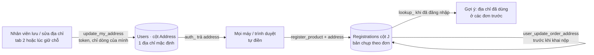

# Địa chỉ nhận hàng v2 — hiện trạng & đề xuất (12/10/2026)

> Trạng thái: **ĐÃ LÀM ở v2.11.0** (12/10/2026). Chủ dự án chọn: 1 địa chỉ trên Sheet · tự đổi địa chỉ đơn trước khi khai nộp · Tỉnh/Thành + chỉ cảnh báo · làm ngay, chủ dự án deploy Apps Script Version 12 (Runbook §3d). Bảng tỉnh → miền (mục 6) do Claude đề xuất theo địa lý 3 miền — **chủ dự án cần xác nhận** (đặc biệt Thanh Hóa / Nghệ An / Hà Tĩnh xếp Miền Trung, Lâm Đồng xếp Miền Trung). Câu hỏi của chủ dự án:
> nút "Thêm địa chỉ" có lưu vào Google Sheet và tự điền lần sau không; nhân viên đổi địa chỉ được không;
> nhiều địa chỉ thì Sheet và giao diện tổ chức thế nào.

## 1. Hiện trạng (đã đọc code v2.10.2 — `Code.gs`, `Mau_Dang_Ky_Internal_Sales_3009.html`)

| Câu hỏi | Hiện tại | Nguồn |
|---|---|---|
| Bấm "Lưu địa chỉ" có ghi vào Google Sheet không? | **Không.** Chỉ lưu trong trình duyệt (`localStorage` khóa `lg_delivery_addr_<Mã NV>`). | `setDeliveryAddress()` |
| Khi nào địa chỉ vào Sheet? | Khi **giữ chỗ**: gửi kèm lệnh `register_product` → Registrations **cột J** của đơn đó (bản chụp theo đơn). | `Code.gs` `regRow[9] = d.address` |
| Lần sau có tự điền không? | **Cùng trình duyệt, cùng máy: có** (kể cả đăng xuất / đăng nhập lại). **Máy khác, trình duyệt khác, trình duyệt trong Zalo, ẩn danh, xóa dữ liệu duyệt web: không** → giờ mở bán bị hỏi lại. | `getDeliveryAddress()` |
| Tab Users có cột địa chỉ không? | **Không.** Users đọc 8 cột A–H (ID, Password, Name, Dept, Phone, Email, Role, Status); đăng nhập không trả địa chỉ. | `auth_()` |
| Đổi địa chỉ được không? | Tab 2 nút **Sửa** → chỉ áp dụng cho **lần giữ chỗ sau**. Đơn đã giữ: web ghi "liên hệ trực tiếp PM phụ trách" → PM sửa tay ô J. | `renderDeliveryAddrRow()` |
| Nhiều địa chỉ? | **Không.** 1 địa chỉ trên máy; mỗi đơn tự lưu địa chỉ riêng ở cột J. | — |
| Ai thấy địa chỉ? | Chủ đơn (tra cứu khi đã đăng nhập), PM (bảng đơn, cửa sổ biên lai, Excel). Tra cứu bằng 4 số cuối SĐT không lộ địa chỉ. | `lookup_()` v2.10 |

**Lỗ hổng chính [suy luận từ code]:** nhân viên thêm địa chỉ trên máy tính công ty, đến 10:00 lại giữ chỗ trên điện thoại (hoặc mở link từ Zalo) → bị hỏi địa chỉ đúng lúc tranh suất FCFS → chậm, dễ mất suất.

## 2. Đề xuất (khuyến nghị)

| # | Hạng mục | Cách làm | Ảnh hưởng | Đợt |
|---|---|---|---|---|
| 1 | **Lưu địa chỉ lên Sheet** | Tab Users thêm cột **Address**, máy chủ tìm theo **tên tiêu đề** (không phụ thuộc vị trí cột; thiếu thì tự thêm). Lệnh mới `update_my_address`: bắt buộc token, chỉ sửa đúng dòng của chính mình, 10–300 ký tự, khóa ghi, nhật ký `ADDRESS_UPDATE`. | Thêm lệnh mới; không đổi lệnh cũ | 1 |
| 2 | **Tự điền trên mọi máy** | `auth_` trả thêm `address`. Web dùng địa chỉ máy chủ; `localStorage` chỉ còn là bộ nhớ đệm. Máy đã có địa chỉ cũ (v2.9–v2.10) mà Sheet còn trống → tự đẩy lên 1 lần khi đăng nhập. | Không mất địa chỉ nhân viên đã nhập | 1 |
| 3 | **Chốt chặn máy chủ** | `register_product` thiếu địa chỉ → máy chủ lấy địa chỉ trong Users. | Không còn đơn trống cột J | 1 |
| 4 | **Gợi ý địa chỉ đã dùng** | Dưới ô nhập: nút "Dùng lại" cho tối đa 3 địa chỉ khác nhau từ các đơn trước (`lookup_` đã trả sẵn). **Không cần sổ địa chỉ riêng.** | Chỉ giao diện | 2 |
| 5 | **Tự đổi địa chỉ đơn đã giữ** | Lệnh `user_update_order_address`: cùng quy tắc "Hủy giữ chỗ" (chỉ khi *Chờ mở thanh toán* / *Chờ nộp tiền*, chưa khai nộp). Ghi chú cột U "Đổi địa chỉ lúc …: cũ → mới" + nhật ký; PM thấy nhãn "Đã đổi địa chỉ". Sau khi khai nộp: vẫn liên hệ PM. | Lệnh mới | 2 |
| 6 | **Chọn Tỉnh/Thành + cảnh báo sai miền** | Ô chọn tỉnh/thành (34 đơn vị sau sáp nhập 01/7/2025) + ô chi tiết; web cảnh báo khi miền ≠ kho (AYA Bắc / AYB Trung / AYC Nam). Cần chủ dự án duyệt **bảng tỉnh → miền**. | Giao diện + dữ liệu mới | 2 (tùy chọn) |

**Vì sao không làm sổ nhiều địa chỉ (bảng Addresses riêng):** mỗi đơn đã tự lưu địa chỉ ở cột J = lịch sử sẵn có; mỗi người
chỉ giữ 1 SP / đợt; sổ địa chỉ cần thêm thêm / sửa / xóa / chọn mặc định → nhiều thao tác hơn đúng lúc tranh suất.
Nếu chủ dự án vẫn muốn: tab mới `Addresses` (EmpCode | Nhãn | Địa chỉ | Mặc định | Cập nhật), tối đa 3 / người.

## 3. Đo lường (định nghĩa trước khi làm)

| Chỉ số | Hiện tại | Mục tiêu | Đo bằng |
|---|---|---|---|
| Lượt giữ chỗ bị hỏi địa chỉ lúc mở bán (người đã lưu trước đó) | Có (khi đổi máy) | **0** | ActivityLog `ADDRESS_UPDATE` vs giờ giữ chỗ |
| Đơn trống địa chỉ (cột J) | 0 trên web; có thể ≠ 0 nếu gọi thẳng API | **0** | Đếm Registrations J rỗng |
| Yêu cầu đổi địa chỉ phải qua PM | Mọi yêu cầu | Chỉ đơn đã khai nộp | Đếm ghi chú "Đổi địa chỉ" |
| Tỷ lệ nhân viên có địa chỉ trước 10:00 14/10 | Không đo được (nằm trên máy) | ≥ 80% | Đếm ô Address không rỗng trong Users |

## 4. Rủi ro & điều kiện

| Rủi ro | Cách xử lý |
|---|---|
| Phải deploy Apps Script **Version 12** sát giờ mở bán | Web mới vẫn chạy với V11 (không có lệnh mới → tự dùng cách cũ, lưu trên máy). Quay lại: V11. |
| **Nạp danh sách nhân viên thật** (dọn tab Users đợt 2) ghi đè tab Users → mất cột Address | Nạp nhân viên thật **trước**, rồi mới mở cột Address; hoặc file nạp giữ nguyên cột Address. Máy chủ tìm cột theo tên nên thứ tự cột không quan trọng. |
| Địa chỉ là dữ liệu cá nhân | Chỉ chủ tài khoản đọc / sửa địa chỉ của mình qua web; PM xem trên đơn như hiện nay; Sheet giữ Restricted. |
| Đổi địa chỉ sau khi PM đã kiểm tra miền | Chỉ cho đổi trước khi khai nộp; mỗi lần đổi ghi vết và hiện nhãn cho PM. |

## 5. Kiểm thử bắt buộc khi làm
Harness máy chủ (token sai / sửa dòng người khác / quá dài / thiếu cột Address / tự thêm cột), bộ điện thoại + máy tính
(VI/EN, Chromium + WebKit + Firefox), luồng 2 máy (máy A lưu → máy B tự điền), hồi quy toàn bộ, chụp lại bộ hướng dẫn.
